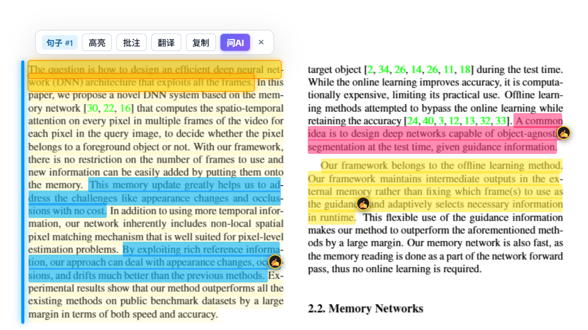
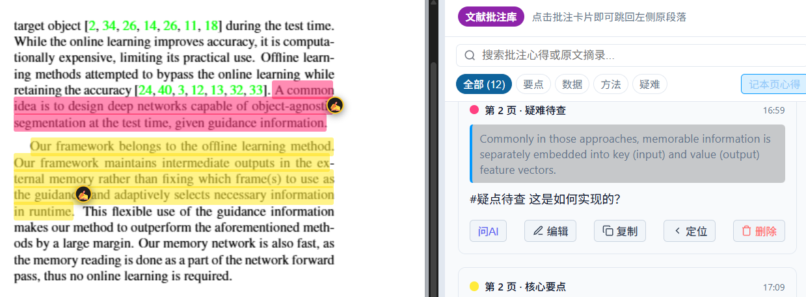
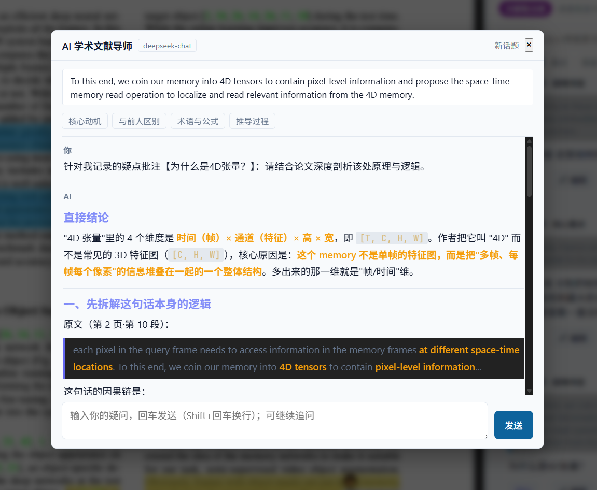

# Bilingual Paper Reader (文献对照翻译阅读器)

专为学术论文研读设计的 **VS Code 双语阅读扩展**：**左侧原版 PDF、右侧对照翻译、公式按版面原图显示、双向高光联动、划线便签批注、一键导出双语精读稿**。

[](https://marketplace.visualstudio.com/items?itemName=paper-reader.academic-pdf-reader)
[](LICENSE)

**VS Code 插件市场一键安装**：[Bilingual Paper Reader](https://marketplace.visualstudio.com/items?itemName=paper-reader.academic-pdf-reader)

---

## 🖼️ 界面预览

| 左右对照与高光联动 | 划线与便签批注 | AI 论文问答 |
| :---: | :---: | :---: |
|  |  |  |

---

## ✨ 核心功能

1. **📖 双栏阅读与阅读顺序修复**
   - **左栏原版渲染**：基于 PDF.js 完整渲染原版 PDF，保留矢量清晰度与原始排版。
   - **智能分段**：自动识别单/双栏、修复跨栏续句与折行断词；图注/标题不再误吞正文。
   - **公式碎片合并**：同一视觉行里的公式上下标与正文合并成一条段落，不再把一段解释拆成十几张顺序错乱的卡片。

2. **🧮 公式按版面原图显示（默认）**
   - **独立公式**：按 PDF 版面原样裁切显示，根号、分式、矩阵、嵌套上下标不会走样；编号式子自动识别为公式卡，不送翻译。
   - **行内公式**：继续用 KaTeX 渲染，可选中、可复制。
   - 关闭 `academicReader.formulaAsImage` 后会退回"文本层抽取 LaTeX + KaTeX 重排"的旧模式。
   - **符号表 / 术语表**（NOMENCLATURE、NOTATION、SYMBOLS…）：整块按版面原图显示，避免逐行硬拆导致符号被劈开。

3. **⚡ 鼠标划词双向高光联动**
   - **左选右亮**：在左侧 PDF 选中任意英文字句，右侧译文卡片立即高亮并自动滚动对齐。
   - **右点左闪**：点击右侧卡片或句对，左侧 PDF 精确定位到原文坐标，逐字符贴合。

4. **✍️ 划线高亮与便签批注**
   - **浮动工具条**：划选文字即弹出工具栏，提供 4 色荧光高亮（🟨核心要点 / 🟩实验数据 / 🟦方法公式 / 🟥疑难待查）、便签与即时翻译。
   - **批注管理**：按页汇总、修改、删除，永久保存在本地。

5. **📝 一键导出双语精读稿**
   - **Markdown**：按页生成「原文 → 双语对照 → 我的批注 → AI 答疑」，带 YAML 头部，可直接导入 Obsidian / Notion。
   - **高光批注 PDF**：按原文坐标绘制高光，附页边序号与译文批注附录，适合打印与分享。

6. **🤖 论文级 AI 导师问答**
   - 结合当前段落、公式和实验上下文提问，支持标准 / 简洁 / 专家等回答风格；聚焦公式时会带上规范 LaTeX 逐符号讲解。

---

## 🆕 最近更新

- **1.6.31**：修复段落顺序（图注误判、公式碎片乱序）、公式裁图上下留白、符号表按版面原图显示；翻译回包后补裁图；混排段落送翻前清洗公式。
- **1.6.20**：新增**本地公式识别**（可选，默认关闭）：用本机 PP-FormulaNet 把公式裁图转成 LaTeX，供精读稿导出、问 AI 与公式索引使用。详见 [docs/formula-local-model.md](docs/formula-local-model.md)。
- 完整版本记录见 [CHANGELOG.md](CHANGELOG.md)。

---

## 🔑 翻译引擎与 API Key 配置

插件支持三种翻译引擎，**选模型、填 Key 即可使用**：

### 1. 内置免费翻译（开箱即用）
无需 API Key。打开 PDF 后点击右上角 **「设置」→「切换为内置免费翻译引擎」**。

### 2. DeepSeek / OpenAI 兼容大模型（推荐）
支持 DeepSeek (`deepseek-chat` / `deepseek-reasoner`)、Kimi、通义千问、智谱 GLM、OpenAI (GPT-4o) 等。

1. 打开任意 PDF，点击右上角 **「设置」**；
2. 选择 **「配置模型 API (DeepSeek / Kimi / 通义 / OpenAI …)」**；
3. 从列表选择模型（会自动带出 API 端点 URL）；
4. 粘贴 API Key 保存。

DeepSeek Key 可在 [platform.deepseek.com](https://platform.deepseek.com/) 创建。

### 3. Google Gemini 官方 API（学术理解强，有免费额度）
1. 点击 **「设置」→「配置 Google Gemini API Key」**；
2. 粘贴 [Google AI Studio](https://aistudio.google.com/app/apikey) 创建的 Key，插件会自动校验。

> 💡 也可通过 `Ctrl+Shift+P` → `配置学术翻译引擎`，或在 VS Code 设置中搜索 `academicReader` 调整并发、目标语言、问答风格等。

---

## 🧠 本地公式识别（可选）

默认关闭，不影响正常阅读。开启后，插件会把**已经裁好的公式图**交给本机 PP-FormulaNet 识别成 LaTeX：

- 需要本机安装 Python + `paddleocr`（CPU 即可）；
- 命令面板搜索 **「启用本地公式识别」** 可自动探测并写入 `formulaModel.pythonPath`；
- 识别结果要过字符守恒校验（覆盖率、多余字符、结构合法性），不通过就保留原图；
- **不参与找框**：框仍由 PDF 文本层决定，模型只负责"框里是什么"。

安装与排错见 [py/README.md](py/README.md) 与 [docs/formula-local-model.md](docs/formula-local-model.md)。

---

## ⚙️ 常用设置

| 设置 | 默认 | 说明 |
| --- | --- | --- |
| `academicReader.formulaAsImage` | `true` | 独立公式按版面原图裁切；关闭则用 KaTeX 重建 |
| `academicReader.segmentationEngine` | `local` | `local` 纯本地；`auto` 可疑页请视觉模型；`vision` 每页都请视觉模型 |
| `academicReader.visionModel` | 空 | 视觉分割使用的多模态模型（如 `deepseek-flash`、`qwen-vl-max`） |
| `academicReader.visionSurgery` | `true` | 允许视觉模型合并/拆分段落（只改分段，不动坐标） |
| `academicReader.formulaModel.enabled` | `false` | 启用本地公式识别 |
| `academicReader.formulaModel.pythonPath` | 空 | 装了 paddleocr 的 Python 解释器路径 |
| `academicReader.translateConcurrency` | `3` | 同时翻译请求数（1~8），遇到限流可调低 |
| `academicReader.targetLanguage` | `zh-CN` | 目标语言 |
| `academicReader.autoTranslate` | `true` | 翻页时自动翻译当前页 |

---

## 📦 安装方式

### 方式 1：VS Code 插件市场（推荐）
在扩展面板（`Ctrl+Shift+X`）搜索 **`Bilingual Paper Reader`**，点击安装。

### 方式 2：VSIX 离线安装
下载 `academic-pdf-reader-<version>.vsix`：
1. 打开 VS Code，按 `Ctrl+Shift+X`；
2. 点击右上角 **`...` → “从 VSIX 安装...”**；
3. 选择 `.vsix` 文件。

命令行安装：

```bash
code --install-extension academic-pdf-reader-<version>.vsix --force
```

---

## 🔒 数据与隐私

- 译文、批注、精读稿缓存保存在本机扩展存储目录，不上传服务器。
- API Key 保存在 VS Code 设置中；只有翻译 / AI 问答请求会发送到你所配置的模型端点。
- 视觉分割开启时，会把**当前页截图**发送给你配置的视觉模型；不需要时可将 `segmentationEngine` 设为 `local`。

---

## 📄 许可证与开源声明

- 遵循 [MIT License](LICENSE)。
- 内嵌 [pdf.js](https://github.com/mozilla/pdf.js) (Apache-2.0) 与 [KaTeX](https://github.com/KaTeX/KaTeX) (MIT)，第三方声明详见 [THIRD-PARTY-NOTICES.md](THIRD-PARTY-NOTICES.md)。
- 欢迎提交 [Issues](https://github.com/SevenFriends7/academic-pdf-reader/issues) 或 Pull Request。
